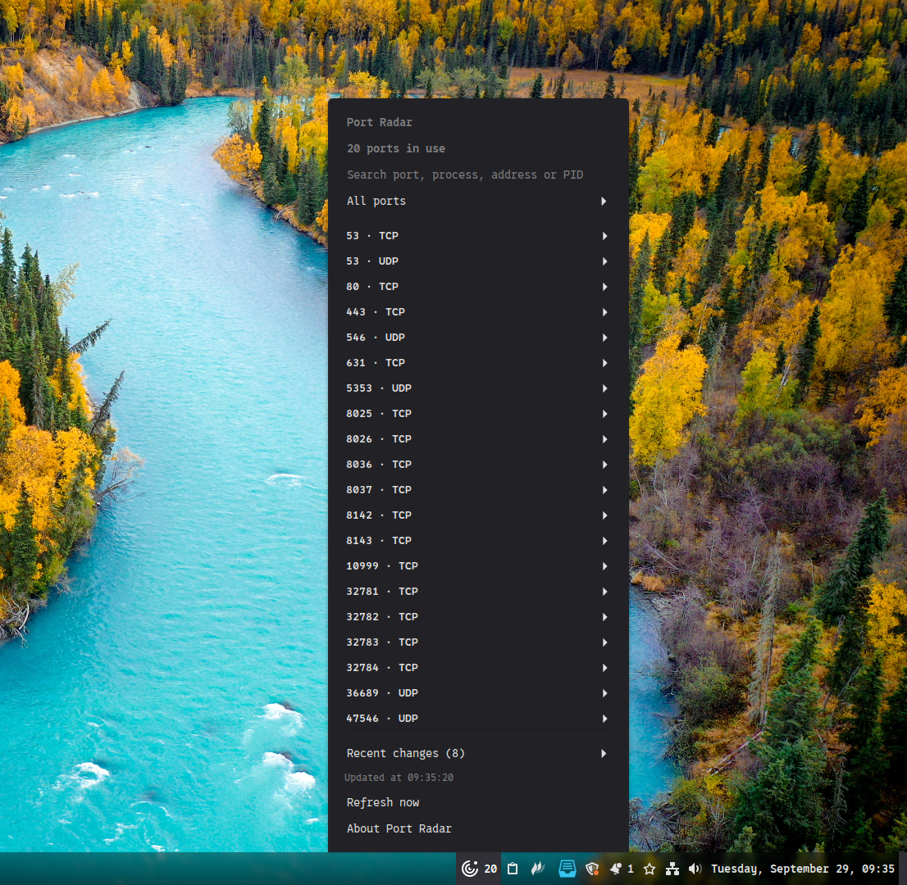

# Port Radar


**See which processes are using local ports, right from your Cinnamon panel.**

[Português](docs/README.pt_BR.md) · **English** · [Español](docs/README.es.md)

Port Radar lists TCP listening sockets and locally bound UDP sockets, with addresses, process names and PIDs when the system makes them available. A quick way to find a forgotten development server or check why a port is busy. By **Pedro Paulo**.



## Features

- TCP, UDP, IPv4 and IPv6, with search by port, process, address or PID.
- Protocol, address family and loopback filters.
- The eight most recent changes: opened or closed sockets, process changes and address changes.
- Manual refresh or updates every 5, 10, 30 or 60 seconds.
- Optional panel counter and a configurable menu entry limit.
- English, Portuguese and Spanish interface, settings and About information.
- Messages for missing dependencies and failed queries.

## Requirements and installation

You need Linux with **Cinnamon 6.0 or later**, `ss` from **iproute2**, and **gettext** to compile translations during installation. The applet uses Cinnamon's CJS runtime and runs as your regular user. No npm or Python packages are required.

Version 6.0 is the declared minimum. The code was checked against the APIs installed with Cinnamon 6.6.9; panel testing and validation on other releases are still pending.

On Linux Mint or Ubuntu with Cinnamon, install missing dependencies:

```bash
sudo apt install iproute2 gettext
```

From the repository root, run the installer **without sudo**:

```bash
bash install.sh
```

Open **System Settings → Applets**, find **Port Radar** and add it to the panel. The installer checks Cinnamon and dependencies, copies the applet to `~/.local/share/cinnamon/applets/port-radar@pedropaulo`, and installs translations under `~/.local/share/locale`. Run it again to update. For an active applet, the installer asks Cinnamon to reload its code over the session D-Bus. If this is unavailable, sign out and back in; refreshing only the panel can retain cached code.

## Everyday use

Click the icon, search or filter the list, and expand an entry to see its address, IP family, process and PID. Use the detail actions to copy a port, address or PID. Expanded port details stay open during updates. **Refresh now** runs a new query. Opening the menu also refreshes it, including in manual mode. The last successful update time appears at the top, and a refresh requested during a scan runs afterwards. Right-click the icon and choose **Configure** to change the refresh interval and display options. **About Port Radar** shows the version and credits.

The applet follows your session language: Portuguese (`pt`, `pt_BR`), Spanish (`es`) or English (`en`, also the fallback). Start a new session after changing your system language.

## Understanding the results

Each row and counter unit represents one protocol/port pair. IPv4 and IPv6 addresses are grouped, while TCP and UDP stay separate. The counter follows the UDP and IPv6 settings, independently of the temporary menu search and filter. Recent changes are collapsed and hidden when empty. TCP entries are in `LISTEN`; UDP entries are locally bound and unconnected. UDP has no TCP-style `LISTEN` state.

When Linux omits process details, the row shows just the port and protocol. Addresses and available process details appear when expanded, without permanent permission notices or empty fields. This is common for another user’s sockets and Docker published ports; container PIDs are not presented as host socket owners. A non-loopback address does not prove internet access: firewalls, routing and service settings still apply. History exists only for the current applet session and records changes between queries, so short-lived sockets can be missed.

On a query failure, the list is hidden and the optional panel counter shows `!`. Previous history remains available. The applet runs `ss` locally; it does not terminate processes, change firewall rules or send results to external services.

## Troubleshooting and development

Check `cinnamon --version` and `ss -lntup` in a terminal. Install `iproute2` if `ss` is missing. Missing process names may be normal permission restrictions; do not run Cinnamon as root. For loading errors, check Cinnamon's Looking Glass (`Alt+F2`, then `lg`) or session logs.

Run the short checks from the repository root:

```bash
bash port-radar@pedropaulo/tests/run-tests.sh
```

Before releasing, check the menu, search, filters, settings, refresh, About and removal/re-addition inside Cinnamon. Check the supported languages in their respective sessions. Module checks do not replace panel testing.

## Releases and publishing

Current version: **0.4.1**. See the [changelog](CHANGELOG.md) and the [Cinnamon Spices preparation guide](docs/SPICES.md). The panel uses the symbolic SVG; the optimized 512 × 512 PNG is the official `icon.png`. Original artwork is retained in the repository root.

## Author and license

**Pedro Paulo** · [GPL-3.0-or-later](LICENSE).
