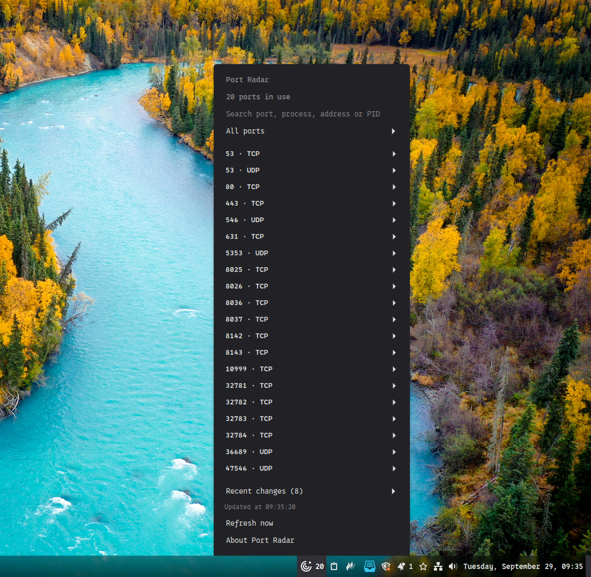

# Port Radar

**Consulta qué procesos usan los puertos locales desde el panel de Cinnamon.**

[Português](README.pt_BR.md) · [English](README.en.md) · **Español**

Port Radar muestra sockets TCP en escucha y sockets UDP locales, con dirección, proceso y PID cuando el sistema permite consultarlos. Una forma rápida de encontrar un servidor de desarrollo olvidado o averiguar por qué un puerto está ocupado. Por **Pedro Paulo**.



## Funciones

- TCP, UDP, IPv4 e IPv6, con búsqueda por puerto, proceso, dirección o PID.
- Filtros por protocolo, familia de direcciones y loopback.
- Los ocho cambios más recientes: aperturas, cierres y cambios de proceso o dirección.
- Actualización manual o cada 5, 10, 30 o 60 segundos.
- Contador opcional en el panel y límite de entradas configurable.
- Interfaz, configuración y créditos en español, portugués e inglés.
- Avisos cuando falta una dependencia o falla una consulta.

## Requisitos e instalación

Necesitas Linux con **Cinnamon 6.0 o posterior**, `ss` del paquete **iproute2** y **gettext** para compilar las traducciones durante la instalación. El applet usa el entorno CJS de Cinnamon y funciona con tu usuario habitual. No necesita paquetes de npm ni de Python.

La versión mínima declarada es 6.0. El código se revisó con las API instaladas de Cinnamon 6.6.9; las pruebas visuales en el panel y la validación en otras versiones siguen pendientes.

En Linux Mint o Ubuntu con Cinnamon, instala las dependencias que falten:

```bash
sudo apt install iproute2 gettext
```

Desde la raíz del repositorio, ejecuta el instalador **sin sudo**:

```bash
bash install.sh
```

Abre **Configuración del sistema → Applets**, busca **Port Radar** y añádelo al panel. El instalador comprueba Cinnamon y las dependencias, copia el applet a `~/.local/share/cinnamon/applets/port-radar@pedropaulo` e instala los idiomas en `~/.local/share/locale`. Para actualizar, ejecútalo de nuevo. El instalador solicita a Cinnamon que recargue el código por D-Bus. Si no está disponible, cierra la sesión y vuelve a entrar; actualizar solo el panel puede conservar código antiguo en caché.

## Uso diario

Pulsa el icono, busca o filtra la lista y abre una entrada para ver su dirección, familia IP, proceso y PID. **Actualizar ahora** realiza una nueva consulta. Abrir el menú también lo actualiza, incluso en modo manual. La hora de la última actualización completada aparece arriba; si solicitas una actualización durante otra consulta, se ejecuta después. Haz clic derecho en el icono y abre **Configurar** para ajustar el intervalo y las opciones de visualización. **Acerca de Port Radar** muestra la versión y los créditos.

El idioma sigue el de tu sesión: español (`es`), portugués (`pt`, `pt_BR`) o inglés (`en`, también usado como alternativa). Inicia una nueva sesión después de cambiar el idioma del sistema.

## Cómo interpretar los resultados

Cada entrada y unidad del contador representa un par protocolo/puerto. Las direcciones IPv4 e IPv6 se agrupan; TCP y UDP siguen separados. El contador respeta las opciones de UDP e IPv6, independientemente de la búsqueda y el filtro temporal del menú. Los cambios recientes aparecen plegados y se ocultan si no hay eventos. TCP muestra sockets en `LISTEN`; UDP muestra sockets locales sin conexión. UDP no tiene el estado `LISTEN` de TCP.

Cuando Linux no proporciona nombre y PID, la entrada muestra solo el puerto y el protocolo. Las direcciones y los datos disponibles aparecen al expandirla, sin avisos permanentes de permisos ni campos vacíos. Es habitual con procesos de otro usuario y puertos publicados por Docker/DDEV; el PID del contenedor no se presenta como propietario del socket del host. Una dirección que no sea loopback no demuestra que exista acceso desde internet: también intervienen el cortafuegos, las rutas y la configuración del servicio. El historial solo se conserva durante la sesión del applet y refleja diferencias entre consultas; los sockets que duran muy poco pueden pasar inadvertidos.

Si una consulta falla, la lista se oculta y el contador opcional muestra `!`. Se conserva el historial anterior. El applet ejecuta `ss` localmente; no cierra procesos, no modifica el cortafuegos ni envía los resultados a servicios externos.

## Problemas y desarrollo

Comprueba `cinnamon --version` y `ss -lntup` en una terminal. Si falta `ss`, instala `iproute2`. La ausencia de nombres de procesos puede deberse a los permisos; no ejecutes Cinnamon como root. Para errores al cargar, consulta Looking Glass (`Alt+F2`, luego `lg`) o los registros de la sesión.

Desde la raíz del repositorio, ejecuta las comprobaciones breves:

```bash
cjs port-radar@pedropaulo/tests/parser-tests.js
cjs port-radar@pedropaulo/tests/scanner-tests.js
cjs port-radar@pedropaulo/tests/changes-tests.js
cjs port-radar@pedropaulo/tests/module-loading-tests.js
cjs port-radar@pedropaulo/tests/refresh-tests.js
```

Antes de publicar, revisa en Cinnamon el menú, la búsqueda, los filtros, la configuración, la actualización, los créditos y la retirada y adición del applet. Revisa también los idiomas en sus sesiones correspondientes. Las pruebas de módulos no sustituyen la revisión del panel.

## Autor y licencia

**Pedro Paulo** · [GPL-3.0-or-later](../LICENSE).
