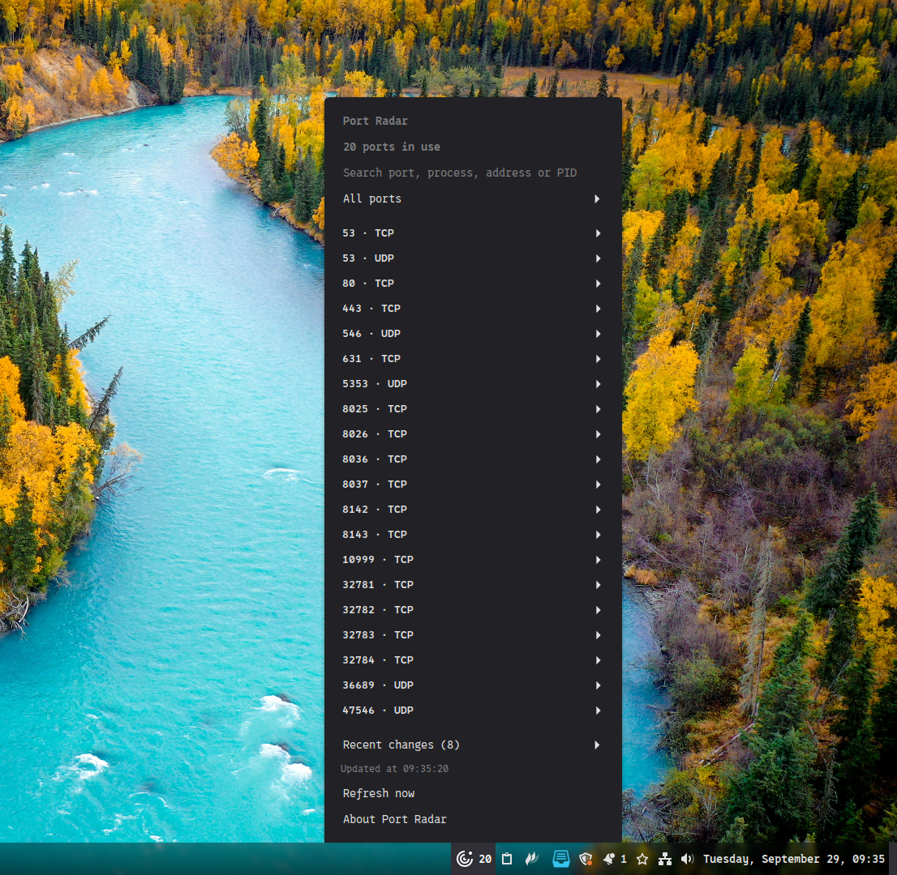

<div align="center">

# Port Radar


**Veja quem está usando as portas do seu computador, direto no painel do Cinnamon.**


**Português** · [English](README.en.md) · [Español](README.es.md)

</div>

---

Um servidor de desenvolvimento ficou aberto? A porta que você precisa já está ocupada? O Port Radar mostra sockets TCP em escuta e sockets UDP locais, com endereço, processo e PID quando essas informações estão disponíveis.

Feito para uma consulta rápida, sem sair do painel. Por **Pedro Paulo**.



*Captura fornecida do applet em uso; a interface acompanha o idioma do sistema.*

## O que você encontra

- Portas TCP e UDP, com suporte a IPv4 e IPv6.
- Busca por porta, processo, endereço ou PID.
- Filtros por protocolo, família de endereço e loopback.
- Histórico das oito alterações mais recentes: abertura, fechamento, troca de processo ou endereço.
- Atualização manual ou a cada 5, 10, 30 ou 60 segundos.
- Contador opcional no painel e limite de itens no menu.
- Interface, configurações e créditos em português, inglês e espanhol.
- Avisos quando falta uma dependência ou a consulta falha.

## Requisitos

| Componente | Requisito |
| --- | --- |
| Ambiente | Linux com Cinnamon **6.0 ou superior** |
| Consulta de portas | `ss`, fornecido pelo pacote `iproute2` |
| Instalação das traduções | `msgfmt`, fornecido pelo pacote `gettext` |
| Permissões | Usuário comum; o applet não precisa de root |

O JavaScript é executado pelo CJS do próprio Cinnamon. Não há dependências de npm ou Python para usar o applet. `gettext` é necessário apenas para compilar os idiomas durante a instalação.

**Compatibilidade:** 6.0 é a versão mínima declarada. O código foi conferido com as APIs disponíveis no Cinnamon 6.6.9; o teste visual no painel e a validação em outras versões ainda estão pendentes.

## Instalação

Baixe o repositório e abra um terminal na pasta que contém este README.

No Linux Mint ou Ubuntu com Cinnamon, instale as dependências que estiverem faltando:

```bash
sudo apt install iproute2 gettext
```

Execute o instalador **sem sudo**:

```bash
bash install.sh
```

Depois, abra **Configurações do sistema → Applets**, procure **Port Radar** e adicione-o ao painel.

O instalador verifica as dependências e a versão do Cinnamon, copia o applet para `~/.local/share/cinnamon/applets/port-radar@pedropaulo` e instala os idiomas em `~/.local/share/locale`. Executá-lo novamente atualiza os arquivos. Se o applet estiver ativo, o instalador solicita ao Cinnamon a recarga do código pela sessão D-Bus. Caso essa integração não esteja disponível, encerre a sessão e entre novamente. Atualizar apenas o painel pode manter o código antigo em cache.

## Como usar

Clique no ícone para abrir a lista. A lista agrupa cada número de porta por protocolo e mostra o processo somente quando identificado. Use a busca e os filtros para encontrar uma porta; expanda a entrada para consultar os endereços e os dados de processo disponíveis. O histórico fica recolhido em **Alterações recentes** e só aparece quando há eventos. **Atualizar agora** faz uma nova consulta. Abrir o menu também atualiza a lista, inclusive no modo manual. O horário da última atualização concluída aparece no topo; uma solicitação feita durante outra consulta é executada logo depois.

Clique com o botão direito no ícone e abra **Configurar** para ajustar o intervalo, o contador e a exibição de UDP e IPv6. O item **Sobre o Port Radar** abre os créditos e a versão.

O idioma acompanha a sessão do sistema. Português (`pt` e `pt_BR`), espanhol (`es`) e inglês (`en`) estão incluídos; inglês também é o idioma de fallback. Após mudar o idioma do sistema, inicie uma nova sessão.

## O que os dados significam

- Uma entrada e uma unidade do contador representam um par **protocolo + porta**. Endereços IPv4 e IPv6 da mesma porta ficam agrupados; TCP e UDP continuam separados. O contador respeita as opções de UDP e IPv6, mas não muda com a busca ou o filtro temporário do menu.
- TCP mostra sockets em estado `LISTEN`. UDP mostra sockets locais sem conexão; UDP não possui o estado TCP `LISTEN`.
- Quando o Linux não fornece nome e PID, a lista mostra apenas a porta e o protocolo; os endereços ficam nos detalhes. A falta desses dados não gera avisos permanentes nem campos vazios. Isso é comum para processos de outro usuário e portas publicadas pelo Docker/DDEV. O applet não confunde o PID de um contêiner com o processo que escuta no host.
- **Outras interfaces** inclui endereços que não são loopback. Isso não comprova acesso pela internet: firewall, roteamento e configuração do serviço também importam.
- O histórico fica apenas na memória e representa diferenças entre consultas. Um socket que abre e fecha entre duas consultas pode não aparecer.
- Durante uma falha, a lista é ocultada e o contador mostra `!`, quando habilitado. O histórico anterior é mantido.

O applet executa `ss` localmente. Não encerra processos, não altera portas ou firewall e não envia os resultados para serviços externos.

## Se algo não aparecer

Confira a versão e a saída da ferramenta no terminal:

```bash
cinnamon --version
ss -lntup
```

Se `ss` não existir, instale `iproute2`. Se os nomes de processos estiverem ausentes também no terminal, pode ser uma restrição de permissões do sistema. Não é necessário executar o Cinnamon como root.

Se o applet não carregar, consulte os erros do Cinnamon no Looking Glass (`Alt+F2`, digite `lg`) ou no diário da sessão. Ao relatar um problema, inclua a versão do Cinnamon, a distribuição e os passos para reproduzir; revise endereços e nomes de processos antes de compartilhar logs.

## Desenvolvimento

```text
port-radar@pedropaulo/
├── applet.js                 # Menu, busca, filtros e ciclo de atualização
├── lib/                      # Leitura, parsing e comparação dos sockets
├── po/                       # Catálogos gettext
├── tests/                    # Verificações curtas do parser e scanner
├── metadata.json
├── settings-schema.json
└── stylesheet.css
```

Verificações rápidas, a partir da raiz do repositório:

```bash
cjs port-radar@pedropaulo/tests/parser-tests.js
cjs port-radar@pedropaulo/tests/scanner-tests.js
cjs port-radar@pedropaulo/tests/changes-tests.js
cjs port-radar@pedropaulo/tests/module-loading-tests.js
cjs port-radar@pedropaulo/tests/refresh-tests.js
```

Antes de publicar uma versão, confira no Cinnamon: abrir o menu, buscar e filtrar, mudar as configurações, atualizar a lista, abrir **Sobre** e remover/adicionar o applet. Confira também os idiomas nas sessões correspondentes. Os testes de módulos não substituem essa validação.

## Versões e publicação

Versão atual: **0.4.1**. Veja o [histórico de alterações](../CHANGELOG.md) e o [guia de preparação para o Cinnamon Spices](SPICES.md). O SVG é usado como ícone simbólico do painel; o PNG otimizado de 512 × 512 é o ícone oficial (`icon.png`). Os arquivos originais de arte permanecem na raiz.

## Autor e licença

**Pedro Paulo** · [GPL-3.0-or-later](../LICENSE).
